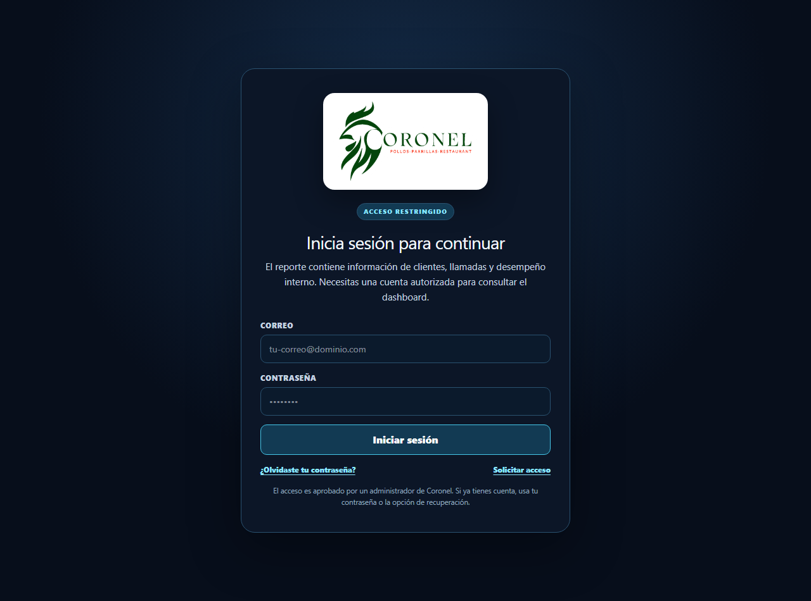
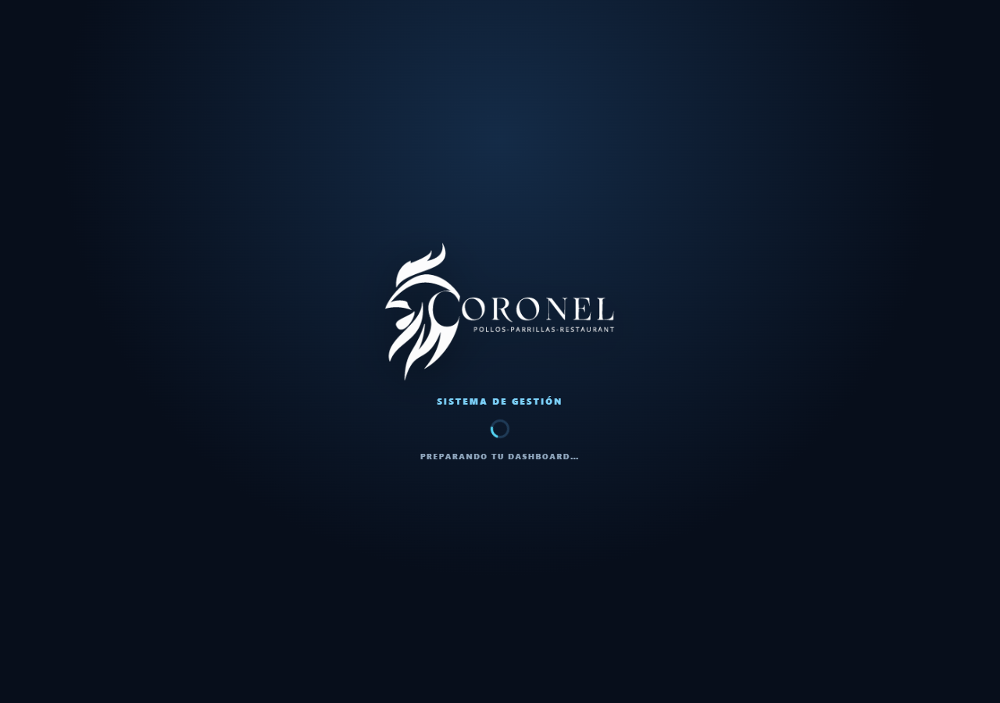
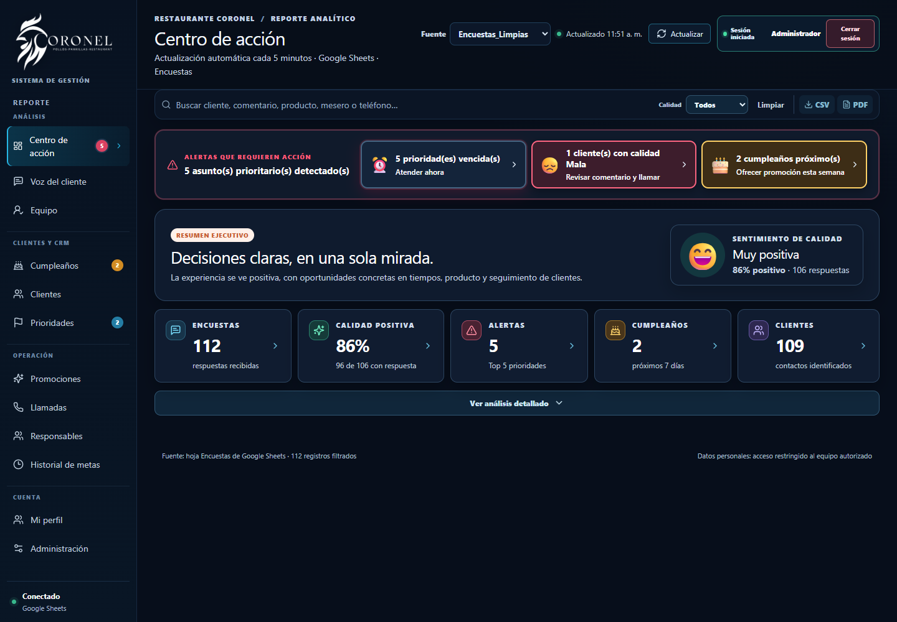
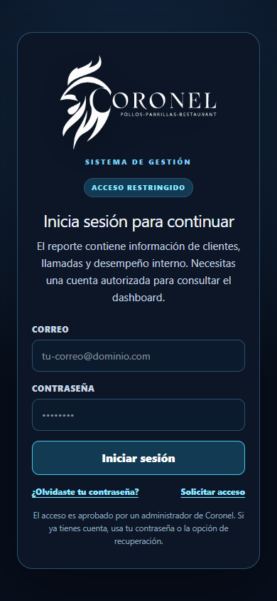
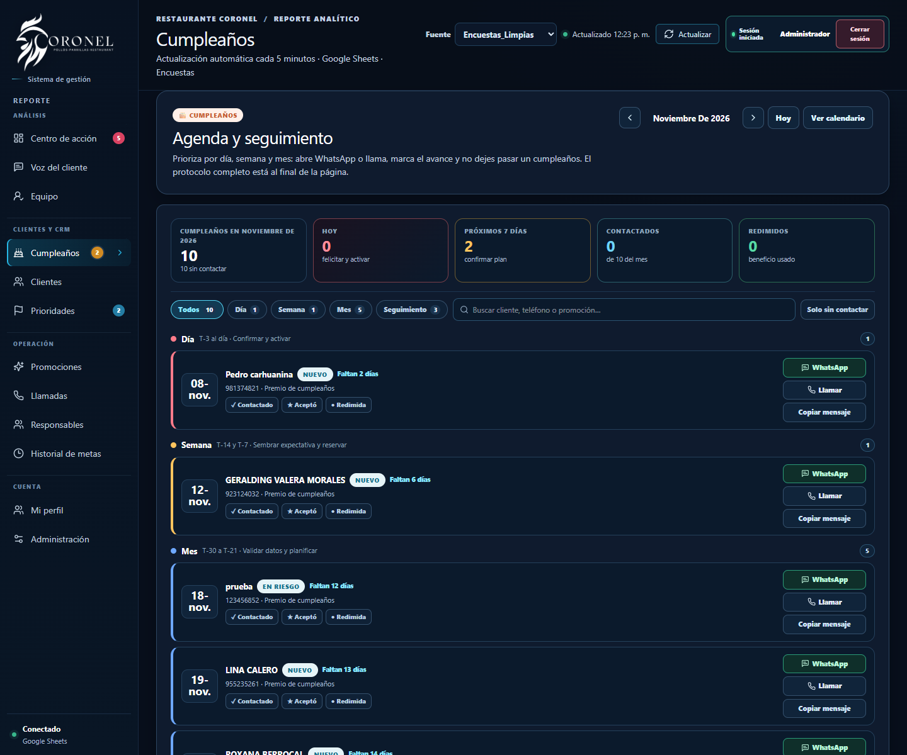
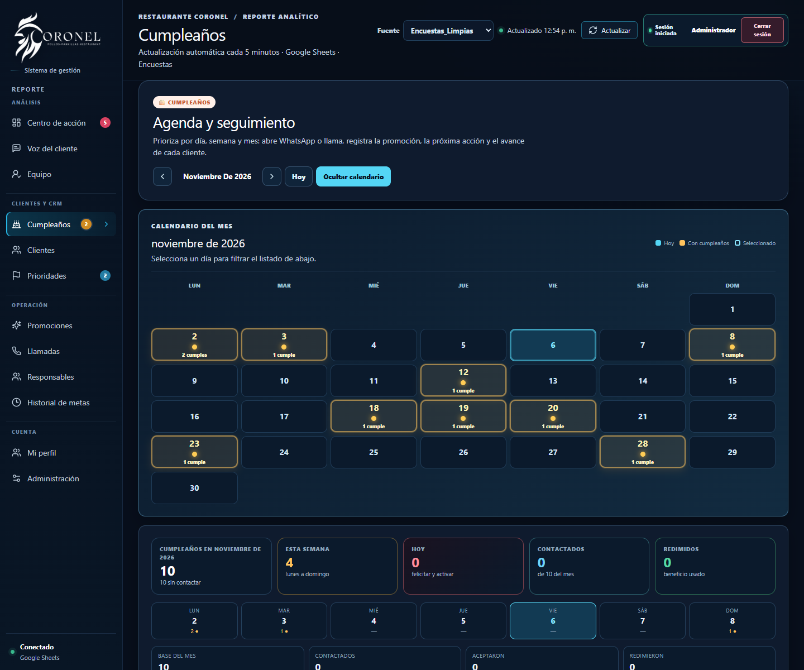
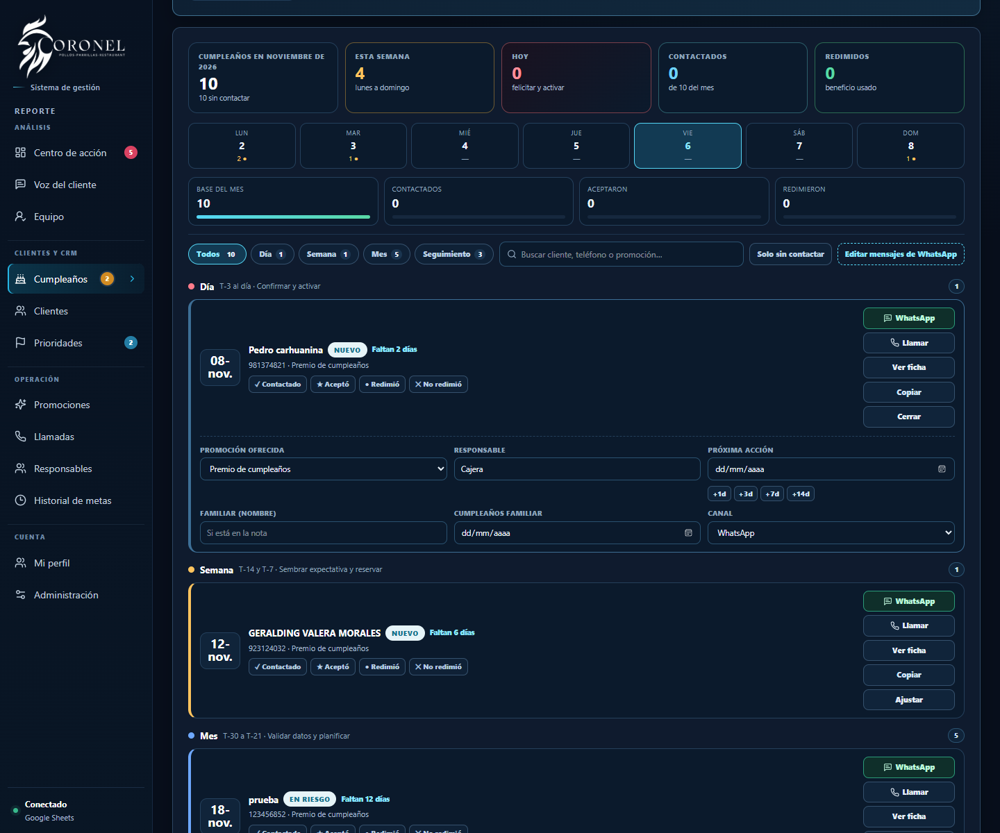
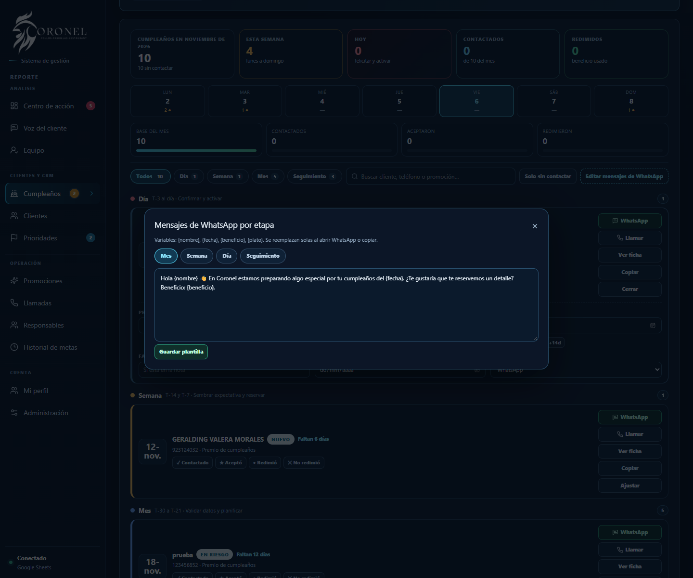
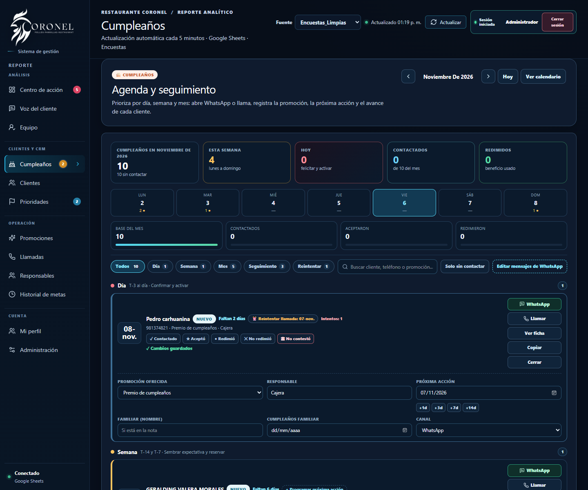
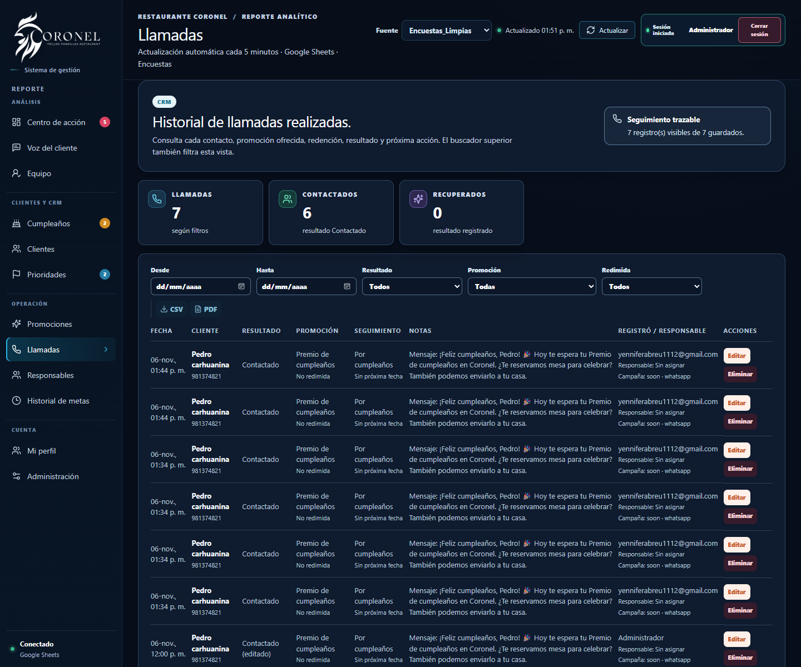

# Coronel · Dashboard de Satisfacción

Dashboard analítico de satisfacción del cliente para **Restaurante Coronel**. Consolida encuestas de Google Sheets, permite gestionar llamadas de recuperación, campañas de cumpleaños, metas del equipo, prioridades y auditoría administrativa.

Migrado desde el stack original de Manus (MySQL/TiDB + OAuth de Manus) a:

| Capa | Tecnología |
|---|---|
| Frontend | React 19 + Vite 7 + Tailwind CSS 4 + tRPC 11 |
| Backend | Node.js 22 + Express 4 + tRPC 11 (bundle ESM con esbuild) |
| Base de datos | PostgreSQL (Supabase) + Drizzle ORM |
| Autenticación | Supabase Auth (email + contraseña, JWT Bearer) |
| Datos de encuestas | Google Sheets (CSV público vía `gviz`) |
| Hosting | Render (Web Service · Node) |

## Estructura

```
client/            SPA de React (páginas, componentes, estilos)
  public/manus-storage/logo1_5c69b281.png   logo servido localmente
server/            API Express + tRPC
  _core/           arranque, contexto, auth Supabase, trpc, static
  db.ts            consultas Drizzle (PostgreSQL)
  routers.ts       contrato tRPC + integración Google Sheets
drizzle/           esquema PostgreSQL y migraciones SQL
database/          respaldo MySQL original + datos convertidos a JSON
scripts/           conversión, importación y pruebas de humo
docs/              guías de despliegue y migración
render.yaml        blueprint de Render
```

## Variables de entorno

Copia `.env.example` a `.env` y completa los valores:

| Variable | Uso |
|---|---|
| `DATABASE_URL` | Connection string de Supabase (usar **Session pooler**, puerto 5432) |
| `SUPABASE_URL` | `https://<proyecto>.supabase.co` |
| `SUPABASE_ANON_KEY` | Clave pública (validación de tokens en el servidor) |
| `SUPABASE_SERVICE_ROLE_KEY` | Solo scripts administrativos (no se usa en el runtime web) |
| `SUPABASE_ADMIN_USER_ID` | UUID del usuario de Supabase Auth con rol administrador |
| `VITE_SUPABASE_URL` / `VITE_SUPABASE_ANON_KEY` | Inyectadas en el bundle del cliente |
| `GOOGLE_SHEET_ID` | ID del Google Sheet de encuestas |
| `GOOGLE_SHEET_TAB` | Pestaña productiva (por defecto `Encuestas_Limpias`). Si no existe o no tiene encabezados de encuestas, el backend usa automáticamente la pestaña `Encuestas`. |
| `JWT_SECRET` | Reservado para sesiones firmadas propias |
| `ADMIN_PIN` | PIN para acciones administrativas sensibles (por defecto `5956`) |
| `PORT` / `NODE_ENV` | Puerto y entorno (Render los define) |

## Desarrollo local

```bash
pnpm install
cp .env.example .env      # completa credenciales
pnpm db:push              # genera y aplica migraciones en Supabase
pnpm db:import            # (opcional) carga el respaldo convertido
pnpm dev                  # http://localhost:3000
```

## Scripts

| Script | Descripción |
|---|---|
| `pnpm dev` | Servidor de desarrollo con Vite middleware |
| `pnpm build` | Compila la SPA (`dist/public`) y el servidor (`dist/index.js`) |
| `pnpm start` | Servidor de producción (`node dist/index.js`) |
| `pnpm check` | Verificación de tipos (TypeScript) |
| `pnpm test` | Pruebas unitarias (Vitest) |
| `pnpm db:generate` / `pnpm db:migrate` / `pnpm db:push` | Migraciones Drizzle |
| `pnpm db:import` | Importa `database/coronel-data.json` a PostgreSQL |
| `pnpm keepalive:setup` / `status` / `test` / `remove` | Keep-alive de Render vía `pg_cron` + `pg_net` de Supabase |
| `node scripts/smoke-test.mjs <url>` | Prueba end-to-end contra un servidor desplegado |
| `node scripts/verify-sheets.mjs <url>` | Verifica la fuente Google Sheets y la pestaña productiva |
| `python scripts/analyze_data.py` | Perfil de calidad de datos (nulos, duplicados, formatos, edades, productos) |
| `node scripts/smoke-access.mjs <url>` | Prueba end-to-end del flujo de altas, aprobación y recuperación |

## Autenticación

1. El navegador inicia sesión en Supabase Auth con la **anon key**.
2. Supabase devuelve un JWT que el cliente envía como `Authorization: Bearer`.
3. El servidor valida el token contra `/auth/v1/user` (caché de 60 s) y sincroniza el usuario en la tabla `users`, usando el UUID de Supabase como `openId`.
4. Si el UUID coincide con `SUPABASE_ADMIN_USER_ID`, el usuario recibe rol `admin` automáticamente; el resto de permisos se administran desde la pantalla de *Accesos*.

Los usuarios se crean desde **Supabase → Authentication → Users** (o con la Admin API). No hay registro público en la aplicación.

## Acceso, altas y recuperación de contraseña

La pantalla `/login` ofrece tres flujos:

| Flujo | Ruta | Descripción |
|---|---|---|
| Iniciar sesión | `/login` | Email + contraseña contra Supabase Auth |
| Recuperar contraseña | `/login?mode=recovery` → `/reset-password` | Supabase envía un enlace al correo; el usuario define una contraseña nueva |
| Solicitar acceso | `/login?mode=request` | Guarda una solicitud en `access_requests`; **ningún usuario entra hasta que un administrador la apruebe** |

**Aprobación de solicitudes (solo administradores):** en el dashboard, pestaña *Accesos* → panel **“Altas pendientes de aprobación”**. Al aprobar con la credencial administrativa:

1. El servidor crea el usuario en Supabase Auth (`email_confirm: true`).
2. Genera una **contraseña temporal** (se muestra una sola vez al administrador para copiarla).
3. Vincula la cuenta local (`users.openId` = uuid de Supabase) y la deja activa.
4. Registra la acción en auditoría.

Además, desde cada cuenta se puede generar una **contraseña temporal** nueva (botón *Contraseña temporal*), como alternativa si el correo de recuperación no llega.

Seguridad adicional: el servidor **no auto-registra** cuentas de Supabase arbitrarias; si un usuario existe en Supabase Auth pero no tiene fila local aprobada, el login falla con “Tu acceso todavía no fue aprobado”. El registro público de Supabase está desactivado.

Requisito de configuración (ya aplicado en este proyecto): en Supabase → Authentication → URL Configuration deben estar el **Site URL** (`https://coronel-dashboard.onrender.com`) y los **Redirect URLs** (`https://coronel-dashboard.onrender.com/**`, `http://localhost:3000/**`, `http://localhost:5173/**`). Ver [`docs/DEPLOY_RENDER_SUPABASE.md`](docs/DEPLOY_RENDER_SUPABASE.md).

## Capturas

| Inicio de sesión | Splash de carga |
|---|---|
|  |  |

| Panel principal (marca blanca) | Login en móvil |
|---|---|
|  |  |

| Cumpleaños (métricas, semana y embudo) | Calendario con estados visibles |
|---|---|
|  |  |

| Tarjeta editable (promoción, próxima acción, familia) | Mensajes de WhatsApp editables |
|---|---|
|  |  |

| Próxima acción vencida y reintentos | Historial de llamadas editable (admin) |
|---|---|
|  |  |

## Identidad visual

- `client/public/manus-storage/logo-blanco.png`: logo **blanco con fondo transparente** para fondos oscuros (login, splash, sidebar).
- `client/public/manus-storage/logo1_5c69b281.png`: versión verde original, usada en el reporte imprimible/PDF (fondo blanco).

Para reemplazar el logo por el oficial: guarda el archivo nuevo como `client/public/manus-storage/logo-blanco.png` (PNG con transparencia, arte blanco, mínimo 800 px de ancho). El código no necesita cambios; también puedes pasarme el archivo y lo integro.

## Análisis y roadmap

Ver [docs/ANALISIS_SISTEMA_GESTION.md](docs/ANALISIS_SISTEMA_GESTION.md): inventario de módulos, diagnóstico, protocolo de cumpleaños propuesto, pulso de meseros/productos y roadmap por fases.

Fuente de datos y revisión del Apps Script: [docs/FUENTE_DATOS_GOOGLE_SHEETS.md](docs/FUENTE_DATOS_GOOGLE_SHEETS.md). Configuración del Apps Script: [integrations/apps-script/README.md](integrations/apps-script/README.md).

Calidad, limpieza y normalización de datos: [docs/ANALISIS_CALIDAD_DATOS.md](docs/ANALISIS_CALIDAD_DATOS.md). Verificación de cálculos de la app: [docs/VERIFICACION_CALCULOS.md](docs/VERIFICACION_CALCULOS.md). Auditoría UX/UI: [docs/UX_AUDIT.md](docs/UX_AUDIT.md). Sistema de diseño: [docs/DESIGN_SYSTEM.md](docs/DESIGN_SYSTEM.md). Rediseño del Centro de acción: [docs/CENTRO_ACCION.md](docs/CENTRO_ACCION.md). Cumpleaños: [docs/CUMPLEANOS.md](docs/CUMPLEANOS.md). Clientes: [docs/CLIENTES.md](docs/CLIENTES.md). Prioridades: [docs/PRIORIDADES.md](docs/PRIORIDADES.md). Auditoría para usuarios no técnicos: [docs/AUDITORIA_NOVATO.md](docs/AUDITORIA_NOVATO.md). Adaptación al negocio: [docs/ADAPTACION_NEGOCIO.md](docs/ADAPTACION_NEGOCIO.md).

## Despliegue

Ver [`docs/DEPLOY_RENDER_SUPABASE.md`](docs/DEPLOY_RENDER_SUPABASE.md) y [`docs/MIGRACION_BASE_DATOS.md`](docs/MIGRACION_BASE_DATOS.md).

## Keep-alive (plan free de Render)

El servicio free de Render duerme tras 15 min de inactividad. Para evitarlo, Supabase ejecuta un job de `pg_cron` que cada 5 minutos hace `GET /healthz` con `pg_net` (sin depender de tu PC ni de cuentas externas), **excepto entre 01:30 y 06:30 hora de Lima**, ventana evaluada en PostgreSQL con `America/Lima`:

```bash
pnpm keepalive:setup   # crea/actualiza el job (idempotente)
pnpm keepalive:status  # ventana actual y últimas ejecuciones
pnpm keepalive:test    # dispara un ping y muestra el HTTP status
pnpm keepalive:remove  # elimina el job
```

Detalle, verificación en SQL y alternativas en [`docs/KEEPALIVE_RENDER.md`](docs/KEEPALIVE_RENDER.md).
